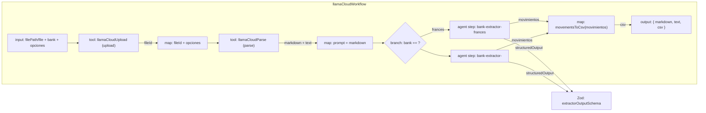

# Design: Bank Extractor Registry

## Resumen

Se reorganiza la extracción de movimientos bancarios para soportar **un agente por banco** con una **salida normalizada común** y un **registro extensible**. El workflow `llamaCloudWorkflow` recibe un parámetro `bank` (obligatorio) y enruta de forma **determinista** (`.branch()`) al agente extractor correspondiente. Todos los agentes de banco comparten el mismo esquema de salida (`extractorOutputSchema`) y un único serializer CSV (`movementsToCsv`).

Con este diseño, agregar un banco nuevo implica únicamente:
1. Crear un agente `bank-extractors/<banco>.ts` con sus instrucciones específicas.
2. Agregar su id a `bankIds` y su entrada en `bankExtractors` (registry).
3. Agregar una tupla `[condición, paso]` en el `.branch()` del workflow.

No se tocan los bancos existentes ni el serializer.

## Decisión de arquitectura

La extracción requiere **razonamiento de LLM** (el markdown de los extractos es irregular: celdas fusionadas, filas de resumen, encabezados de cuenta). Sin embargo, **escribir CSV exacto (RFC 4180) es frágil para un LLM**, por lo que el LLM devuelve filas estructuradas (Zod) y la serialización CSV la hace una función determinista. Este principio (spec `bank-movements-extractor`) se mantiene.

Lo nuevo es el **ruteo por banco**. Se evalúan dos alternativas:

| Opción | Descripción | Veredicto |
|--------|-------------|-----------|
| `.branch()` con `createStep(agent, { structuredOutput })` por banco | Cada agente de banco es un paso declarativo de rama; el branch selecciona uno según `bank`. Visible en el grafo de Studio, determinista, sin LLM extra. | ✅ Correcto |
| Paso único con lookup dinámico del agente (`mastra.getAgent(bank)`) | Un `createStep` genérico resuelve el agente en runtime. Más compacto pero el agente deja de ser un paso declarativo (pierde visibilidad/persistencia del grafo y tipado del paso). | ❌ |
| Subagentes (`agents` del agente general) | Un agente supervisor delega según su criterio. No determinista y rompe la arquitectura workflow actual. | ❌ |

Se elige **`.branch()`**: es determinista (parámetro `bank`), escalable y mantiene cada agente de banco como paso de primera clase en el grafo del workflow.

## Arquitectura



## Dependencia

| Paquete | Versión | Propósito |
|---------|---------|-----------|
| `@mastra/core` | 1.75.0 (ya instalado) | `Agent`, `createWorkflow`, `createStep`, `Workflow.branch()` |
| `zod` | ^4.4.3 (ya instalado) | `z.enum` y esquemas de salida |

No se agregan dependencias nuevas.

## Configuración

- **Modelo**: `opencode-go/kimi-k2.7-code` para todos los agentes de banco (verificado en el provider registry).
- **API key**: `OPENCODE_API_KEY` (ya documentada en `.env.example`), nunca hardcodeada.
- Los agentes de banco **no tienen tools ni workspace**: son tareas puras de extracción con structured output.

## Estructura de archivos

```
src/mastra/agents/
├── agent.ts                          # MODIFICADO: instrucciones del tool (solicitar bank)
├── opencode-headers.ts               # sin cambios
└── bank-extractors/
    ├── types.ts                      # NUEVO: movimientoRowSchema, extractorOutputSchema, movementsToCsv, MovimientoRow
    ├── registry.ts                   # NUEVO: bankIds, BankId, bankIdSchema, bankExtractors
    ├── frances.ts                    # NUEVO: agente Banco Francés
    └── index.ts                      # NUEVO: re-exports
```

Se elimina `src/mastra/agents/bank-movements-extractor.ts`.

## Módulo compartido: `types.ts`

Se mueven desde `bank-movements-extractor.ts` los símbolos compartidos, sin cambios de comportamiento:

```typescript
import { z } from 'zod';

export const movimientoRowSchema = z.object({
  cuenta: z.string().describe('Número de cuenta (NRO) al que pertenece el movimiento, p. ej. "3-320-0941456600-5".'),
  fecha: z.string().describe('Fecha del movimiento, p. ej. "03/01/23".'),
  descripcion: z.string().describe('Descripción del movimiento.'),
  referencia: z.string().describe('Referencia. Puede estar vacía.'),
  debitos: z.string().describe('Importe débito tal como figura en el extracto. Puede estar vacío.'),
  creditos: z.string().describe('Importe crédito tal como figura en el extracto. Puede estar vacío.'),
  saldo: z.string().describe('Saldo tal como figura en el extracto, sin recalcular.'),
});

export const extractorOutputSchema = z.object({
  movimientos: z
    .array(movimientoRowSchema)
    .describe('Todos los movimientos de todas las tablas extraídas, consolidados en un solo arreglo.'),
});

export type MovimientoRow = z.infer<typeof movimientoRowSchema>;

export function movementsToCsv(
  movimientos: z.infer<typeof extractorOutputSchema>['movimientos']
): string {
  const header = ['CUENTA', 'FECHA', 'DESCRIPCION', 'REFERENCIA', 'DEBITOS', 'CREDITOS', 'SALDO'];
  const escape = (value: string) => `"${value.replace(/"/g, '""')}"`;
  const rows = movimientos.map((m) =>
    [m.cuenta, m.fecha, m.descripcion, m.referencia, m.debitos, m.creditos, m.saldo]
      .map(escape)
      .join(',')
  );
  return [header.map(escape).join(','), ...rows].join('\n');
}
```

> Los valores monetarios y las fechas se modelan como `string` para preservar el formato original del extracto (puntos separadores de miles, comas decimales, fechas `DD/MM/AA`).

## Registro: `registry.ts`

Fuente de verdad de los bancos soportados. De aquí se derivan el enum de Zod y el mapa banco→agente:

```typescript
import { z } from 'zod';
import type { Agent } from '@mastra/core/agent';
import { bankExtractorFrances } from './frances';

export const bankIds = ['frances'] as const;

export type BankId = (typeof bankIds)[number];

export const bankIdSchema = z.enum(bankIds);

export const bankExtractors: Record<BankId, Agent> = {
  frances: bankExtractorFrances,
};
```

### Justificación

- **`bankIds` como fuente de verdad**: `BankId`, `bankIdSchema` y `bankExtractors` derivan del mismo array, evitando desincronizaciones.
- **Convención de id de agente**: `bank-extractor-<bank>`. Coincide con el id del agente, que es también el id del paso de rama (ver `createStep`). El `.map()` final lo reconstruye a partir de `bank`.
- **Extensibilidad**: agregar un banco = agregar `'<banco>'` a `bankIds` + una entrada en `bankExtractors` + una rama en el workflow.

## Agente por banco: `frances.ts`

Se migra el agente actual del Francés con las mismas instrucciones de extracción, cambiando el `id` a la convención `bank-extractor-frances`:

```typescript
import { Agent } from '@mastra/core/agent';
import { opencodeGoHeaders } from '../opencode-headers';

export const bankExtractorFrances = new Agent({
  id: 'bank-extractor-frances',
  name: 'Bank Extractor - Banco Francés',
  description:
    'Extrae los movimientos bancarios del markdown de un extracto del Banco Francés procesado por LlamaCloud.',
  model: [
    {
      id: 'extractor',
      model: 'opencode-go/kimi-k2.7-code',
      headers: opencodeGoHeaders,
    },
  ],
  instructions: `Eres un extractor de movimientos bancarios del Banco Francés. Recibes el markdown de un extracto bancario (producido por LlamaCloud) que contiene tablas HTML.

Tarea:
1. Identifica únicamente las tablas de movimientos (columnas FECHA, DESCRIPCION, REFERENCIA, DEBITOS, CREDITOS, SALDO).
   Ignora la tabla de "Información de su/s Cuenta/s" (TIPO CUENTA, SUCURSAL, MONEDA, CUENTA, CBU).
2. Para cada fila de movimiento, asóciala a su número de cuenta (NRO) tomado del encabezado previo
   (p. ej. "CUENTA CORRIENTE BANCARIA NRO.: 3-320-0941456600-5").
3. Consolida TODOS los movimientos de TODAS las tablas en un único arreglo "movimientos".
   - Excluye las filas de resumen (SALDO ULTIMO EXTRACTO, SALDO FINAL, TOTAL COBRADO...).
   - Si una fila trae fecha y descripción fusionadas en una celda (p. ej. "03/01/23 TELECOM ARG.STET-FRANCE SA"),
     sepáralas en "fecha" y "descripcion" respectivas.
   - Conserva las celdas vacías (referencia, debitos, creditos) sin inventar valores.
   - NO recalcules ni modifiques los valores de débitos, créditos ni saldo.
4. Si el markdown no contiene movimientos, devuelve "movimientos": [].
`,
});
```

Cada banco nuevo repite este patrón con sus instrucciones específicas y el mismo esquema compartido.

## Workflow: `llama-cloud-workflow.ts`

### Input

Se agrega `bank` (obligatorio) al `inputSchema`. Se mantiene el `.refine` de `filePath`/`file`:

```typescript
const inputSchema = z
  .object({
    filePath: z.string().optional().describe('Ruta local absoluta o relativa del PDF.'),
    file: fileInputSchema.optional().describe('PDF codificado en base64 (name + data).'),
    bank: bankIdSchema.describe('Banco del extracto (ej. "frances").'),
    tier: z.enum(['fast', 'cost_effective', 'agentic', 'agentic_plus']).optional(),
    version: z.string().optional(),
    expand: z.array(z.string()).optional(),
    pollingInterval: z.number().optional(),
    timeout: z.number().optional(),
  })
  .refine((data) => data.filePath || data.file, {
    message: 'Debe proporcionar filePath o file.',
  });
```

### Pasos de rama

Se crea un paso por banco con `createStep(agent, { structuredOutput })`. `createStep` toma como `id` del paso el `id` del agente (`bank-extractor-frances`):

```typescript
import { createWorkflow, createStep } from '@mastra/core/workflows';
import { z } from 'zod';
import { llamaCloudUpload, llamaCloudParse } from '../tools/llama-cloud-tool';
import { bankIdSchema, bankExtractors } from '../agents/bank-extractors';
import { extractorOutputSchema, movementsToCsv, type MovimientoRow } from '../agents/bank-extractors/types';

const francesExtractorStep = createStep(bankExtractors.frances, {
  structuredOutput: { schema: extractorOutputSchema },
});
```

Todos los pasos de rama comparten `inputSchema = { prompt: string }` y `outputSchema = extractorOutputSchema`, cumpliendo la restricción de `.branch()`.

### Pipeline

```typescript
export const llamaCloudWorkflow = createWorkflow({
  id: 'llama-cloud-workflow',
  inputSchema,
  outputSchema: z.object({
    markdown: z.string().describe('Contenido completo en markdown.'),
    text: z.string().describe('Contenido completo en texto plano.'),
    csv: z
      .string()
      .describe(
        'CSV consolidado (RFC 4180) con una fila por movimiento de todas las tablas: columnas CUENTA | FECHA | DESCRIPCION | REFERENCIA | DEBITOS | CREDITOS | SALDO.'
      ),
  }),
})
  .tool(llamaCloudUpload, {}, { id: 'upload' })
  .map(async ({ inputData, getInitData }) => ({
    fileId: inputData.fileId,
    tier: getInitData<InputType>().tier,
    version: getInitData<InputType>().version,
    expand: getInitData<InputType>().expand,
    pollingInterval: getInitData<InputType>().pollingInterval,
    timeout: getInitData<InputType>().timeout,
  }))
  .tool(llamaCloudParse, {}, { id: 'parse' })
  .map(async ({ inputData }) => ({
    prompt: `Extrae los movimientos bancarios del siguiente markdown:\n\n${inputData.markdown}`,
  }))
  .branch([
    [async ({ getInitData }) => getInitData<InputType>().bank === 'frances', francesExtractorStep],
    // Agregar aquí una tupla por cada banco nuevo:
    // [async ({ getInitData }) => getInitData<InputType>().bank === 'otro', otroExtractorStep],
  ])
  .map(async ({ inputData, getStepResult, getInitData }) => {
    const { markdown, text } = getStepResult<{ markdown: string; text: string }>('parse');
    const bank = getInitData<InputType>().bank;
    const stepId = `bank-extractor-${bank}`;
    const result = (inputData as Record<string, { movimientos: MovimientoRow[] } | undefined>)[stepId];
    return {
      markdown,
      text,
      csv: movementsToCsv(result?.movimientos ?? []),
    };
  })
  .commit();
```

### Justificación del branch

1. **Condiciones**: usan `getInitData<InputType>().bank` (no `inputData`), porque el dato que fluye hacia la rama es `{ prompt }` (el input del agente) y `bank` vive en el input inicial del workflow.
2. **`.map()` final**: después de `.branch()` el output queda indexado por el `id` del paso ejecutado (`{ 'bank-extractor-frances': { movimientos } }`). El map reensambla `markdown`/`text` (de `parse`) y reconstruye el id del paso con la convención `bank-extractor-${bank}` para leer los movimientos de la rama que corrió.
3. **Output final** `{ markdown, text, csv }` se mantiene idéntico a la spec `bank-movements-extractor`.

> **Observabilidad**: `fileId`/`name` de la subida y `markdown`/`text` del parseo quedan en `run.steps` (`upload`, `parse`) sin contaminar el output final.

## Tool: `process-bank-statement.ts`

Se agrega `bank` (obligatorio) y se reenvía al workflow:

```typescript
inputSchema: z.object({
  bank: bankIdSchema.describe('Banco del extracto (ej. "frances").'),
  filePath: z.string().optional().describe('Ruta local absoluta o relativa del PDF.'),
  file: fileInputSchema.optional().describe('PDF codificado en base64 (name + data).'),
  tier: z.enum([...]).optional(),
  version: z.string().optional(),
  expand: z.array(z.string()).optional(),
  pollingInterval: z.number().optional(),
  timeout: z.number().optional(),
}),
```

En `execute`, el `run.start({ inputData: { ...fileInput, bank: input.bank, tier, version, expand, pollingInterval, timeout } })` incluye `bank`.

## Agente general: `agent.ts`

Se actualiza la instrucción (línea 59) para que solicite el banco cuando el usuario quiera procesar un extracto:

> When the user wants to process a PDF bank statement, ask for the local file path (e.g. `workspace/statement.pdf`) **and the bank (e.g. `frances`)** if not provided. Invoke `process_bank_statement` with `filePath` and `bank`.

## Registro en `src/mastra/index.ts`

Se registra cada agente de banco por su `id` de agente:

```typescript
import { agent } from './agents/agent';
import { bankExtractors } from './agents/bank-extractors';

export const mastra = new Mastra({
  // ...
  agents: {
    agent,
    ...Object.fromEntries(Object.values(bankExtractors).map((a) => [a.id, a])),
  },
  // ...
});
```

## Manejo de errores

- **`bank` inválido** → `bankIdSchema` (zod) rechaza el input antes de ejecutar (error de validación con mensaje claro del enum). El workflow no arranca.
- **`bank` válido sin rama definida** → solo puede ocurrir si `bankIds` y el `.branch()` se desincronizan; se recomienda mantener ambos en sync (Story 3/4). A futuro se puede agregar una rama `fallback` con condición `async () => true` que lance un error descriptivo.
- **markdown vacío o sin movimientos** → el agente devuelve `{ movimientos: [] }`; `movementsToCsv([])` devuelve el CSV con solo el encabezado.
- **API key faltante (`OPENCODE_API_KEY`)** → el model router lanza; el paso de agente falla y el workflow termina `failed`.

## Verificación

1. Compilación: `npx tsc --noEmit`.
2. Registro: `npx mastra api agent list --pretty` debe listar `bank-extractor-frances`.
3. Studio: el workflow `llama-cloud-workflow` muestra el grafo `upload → map → parse → map → branch(frances) → map`.
4. Serializer aislado: `movementsToCsv` con filas de ejemplo (encabezado, columna CUENTA primero, escape RFC 4180).
5. End-to-end:
   ```bash
   npx mastra api workflow run start llama-cloud-workflow \
     '{"inputData":{"filePath":"ruta/al/documento.pdf","bank":"frances"}}'
   ```
   Debe devolver `{ markdown, text, csv }`.
6. Caso borde: `bank` omitido o inválido → error de validación (no ejecuta).

## Ubicación del código (resumen de cambios)

```
src/mastra/
├── index.ts                                    # MODIFICADO: registro de agentes de banco
├── agents/
│   ├── agent.ts                                # MODIFICADO: instrucción solicita bank
│   ├── opencode-headers.ts                     # sin cambios
│   ├── bank-movements-extractor.ts             # ELIMINADO (migrado)
│   └── bank-extractors/
│       ├── types.ts                            # NUEVO: schema compartido + movementsToCsv
│       ├── registry.ts                         # NUEVO: bankIds/BankId/bankIdSchema/bankExtractors
│       ├── frances.ts                          # NUEVO: agente Banco Francés
│       └── index.ts                            # NUEVO: re-exports
├── tools/
│   └── process-bank-statement.ts               # MODIFICADO: input bank obligatorio
└── workflows/
    └── llama-cloud-workflow.ts                 # MODIFICADO: bank + branch por banco
```
