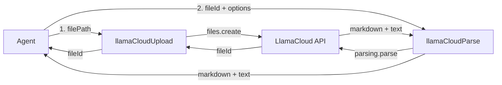

# Design: LlamaCloud Tool

## Resumen

Se crean dos tools de Mastra independientes que envuelven la API de LlamaCloud (`@llamaindex/llama-cloud`):

1. **`llamaCloudUpload`** — sube un PDF local a LlamaCloud y devuelve su `fileId`.
2. **`llamaCloudParse`** — parsea un `fileId` ya subido y devuelve markdown/texto plano.

Separar upload de parse sigue el principio de single responsibility, permite re-parsear el mismo archivo con distintas opciones y refleja la división real de la API (`client.files.create` ≠ `client.parsing.parse`).

## Arquitectura



## Dependencia

| Paquete | Versión | Propósito |
|---------|---------|-----------|
| `@llamaindex/llama-cloud` | latest | SDK de LlamaCloud para subir y parsear documentos |
| `@mastra/core` | 1.75.0 (ya instalado) | API `createTool` |
| `zod` | ^4.4.3 (ya instalado) | Esquemas de entrada/salida |

## Configuración

- **API Key**: `process.env.LLAMA_CLOUD_API_KEY` (nunca hardcodeada).
- **Cliente**: se instancia una única vez `new LlamaCloud({ apiKey })` y se comparte entre ambas tools (módulo con el cliente exportado o una factory).
- **`.env.example`**: agregar `LLAMA_CLOUD_API_KEY=llx-...`.

## Tool 1: `llamaCloudUpload`

```typescript
export const llamaCloudUpload = createTool({
  id: 'llama_cloud_upload',
  description: 'Sube un archivo PDF local a LlamaCloud y devuelve su fileId.',
  inputSchema: z.object({
    filePath: z.string().describe('Ruta local absoluta o relativa del PDF.'),
  }),
  outputSchema: z.object({
    fileId: z.string(),
  }),
  execute: async ({ filePath }) => {
    // 1. Validar que el archivo existe (fs.existsSync) y es legible
    // 2. client.files.create({ file: fs.createReadStream(filePath), purpose: 'parse' })
    // 3. Retornar { fileId: fileObj.id }
  },
});
```

## Tool 2: `llamaCloudParse`

```typescript
export const llamaCloudParse = createTool({
  id: 'llama_cloud_parse',
  description: 'Parsea un archivo ya subido a LlamaCloud y devuelve markdown y texto plano.',
  inputSchema: z.object({
    fileId: z.string().describe('ID del archivo devuelto por llm_cloud_upload.'),
    tier: z.enum(['cost_effective', 'quality']).optional(),
    version: z.string().optional(),
    expand: z.array(z.string()).optional(),
    pollingInterval: z.number().optional(),
    timeout: z.number().optional(),
  }),
  outputSchema: z.object({
    markdown: z.string(),
    text: z.string(),
  }),
  execute: async ({ fileId, tier, version, expand, pollingInterval, timeout }) => {
    // 1. client.parsing.parse({ file_id: fileId, tier, version, expand, ... })
    //    con pollingInterval/timeout si se pasan
    // 2. Retornar { markdown: result.markdown_full ?? '', text: result.text_full ?? '' }
  },
});
```

## Registro

### 1. `src/mastra/index.ts`

```typescript
import { llamaCloudUpload, llamaCloudParse } from './tools/llama-cloud-tool';

// ...
tools: {
  startScheduleTool,
  stopScheduleTool,
  llamaCloudUpload,
  llamaCloudParse,
},
```

### 2. `src/mastra/agents/agent.ts`

El agente por defecto mantiene su propia lista de `tools`, por lo que también deben agregarse allí para que el agente pueda invocarlas.

```typescript
import { llamaCloudUpload, llamaCloudParse } from '../tools/llama-cloud-tool';

// ...
tools: {
  ask_user: askUserTool,
  start_schedule: startScheduleTool,
  stop_schedule: stopScheduleTool,
  llama_cloud_upload: llamaCloudUpload,
  llama_cloud_parse: llamaCloudParse,
  web_fetch: webFetchTool,
  web_search: webSearchTool,
},
```

## Manejo de errores

- **Archivo inexistente** → `throw new Error(...)` con mensaje claro.
- **API key faltante** → validar al instanciar el cliente.
- **Parseo fallido/cancelado** → LlamaCloud lanza (`FAILED`/`CANCELLED`); dejar que el error se propague.

## Ubicación del código

```
src/mastra/
├── index.ts                     # registro de tools
└── tools/
    ├── schedule-tools.ts        # existente
    └── llama-cloud-tool.ts      # NUEVO: ambas tools + cliente compartido
```
