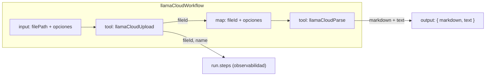

# Design: LlamaCloud Workflow

## Resumen

Se crea un workflow de Mastra (`llamaCloudWorkflow`) que orquesta el procesamiento de un PDF de principio a fin: sube el archivo con la tool existente `llamaCloudUpload` y lo parsea con la tool existente `llamaCloudParse`, devolviendo el markdown y el texto plano.

## Decisión de arquitectura: ¿agentes o workflow?

**No se crean agentes.** El flujo `upload → parse` es un proceso **determinista y lineal**:

- El output del paso 1 (el `fileId`) alimenta directamente el input del paso 2.
- No existe toma de decisiones ni razonamiento de LLM entre pasos.

| Opción | Descripción | Veredicto |
|--------|-------------|-----------|
| Un agente por tool | Cada tool envuelta en un agente. Añade una capa LLM redundante alrededor de una llamada determinista. | ❌ Anti-patrón: latencia, costo de tokens y no-determinismo sin beneficio. |
| Un agente con las 2 tools | Útil solo para control conversacional abierto ("¿subo, parseo o re-parseo?"). | ⚠️ Fuera de alcance: el caso de uso es un pipeline fijo. |
| **Workflow compuesto por tools** | Pasos declarativos `.tool()` sobre `llamaCloudUpload` y `llamaCloudParse`. | ✅ Correcto: determinista, reutiliza las tools, visible en Studio. |

Si en el futuro se requiere un punto de entrada conversacional, el agente existente ya puede invocar el workflow vía `mastra.getWorkflow('llamaCloudWorkflow')` — sin crear agentes nuevos.

## Arquitectura



## Dependencia

| Paquete | Versión | Propósito |
|---------|---------|-----------|
| `@mastra/core` | 1.75.0 (ya instalado) | API `createWorkflow` / `.tool()` / `.map()` / `.commit()` (`@mastra/core/workflows`) |
| `zod` | ^4.4.3 (ya instalado) | Esquemas de entrada/salida |

No se agregan dependencias nuevas: el workflow importa las tools ya registradas de `llama-cloud-tool`.

## Configuración

- **API Key**: `process.env.LLAMA_CLOUD_API_KEY` (ya gestionada por el cliente compartido de las tools; el workflow no la toca).
- No se requiere configuración adicional de entorno.

## Estructura del código

```
src/mastra/
├── index.ts                        # registro del workflow (workflows: {...})
├── workflows/
│   └── llama-cloud-workflow.ts     # NUEVO: llamaCloudWorkflow
└── tools/
    ├── schedule-tools.ts           # existente
    └── llama-cloud-tool.ts         # existente: llamaCloudUpload y llamaCloudParse
```

## Workflow: `llamaCloudWorkflow`

```typescript
import { createWorkflow } from '@mastra/core/workflows';
import { z } from 'zod';
import { llamaCloudUpload, llamaCloudParse } from '../tools/llama-cloud-tool';

export const llamaCloudWorkflow = createWorkflow({
  id: 'llama-cloud-workflow',
  inputSchema: z.object({
    filePath: z.string().describe('Ruta local absoluta o relativa del PDF.'),
    tier: z
      .enum(['fast', 'cost_effective', 'agentic', 'agentic_plus'])
      .optional()
      .describe('Tier de parseo.'),
    version: z.string().optional().describe('Versión del tier.'),
    expand: z
      .array(z.string())
      .optional()
      .describe('Campos a expandir en la respuesta (ej. markdown_full, text_full).'),
    pollingInterval: z
      .number()
      .optional()
      .describe('Intervalo inicial de polling en segundos.'),
    timeout: z.number().optional().describe('Tiempo máximo de espera en segundos.'),
  }),
  outputSchema: z.object({
    markdown: z.string().describe('Contenido completo en markdown.'),
    text: z.string().describe('Contenido completo en texto plano.'),
  }),
})
  .tool(llamaCloudUpload, {
    id: 'upload',
  })
  .map(async ({ inputData, getInitData }) => ({
    fileId: inputData.fileId,
    tier: getInitData().tier,
    version: getInitData().version,
    expand: getInitData().expand,
    pollingInterval: getInitData().pollingInterval,
    timeout: getInitData().timeout,
  }))
  .tool(llamaCloudParse, {
    id: 'parse',
  })
  .commit();
```

### Justificación de cada paso

1. **`.tool(llamaCloudUpload)`** — paso declarativo que recibe el input del workflow (`filePath`) y devuelve `{ fileId, name }`. El input del workflow incluye el `filePath` obligatorio que satisface el `inputSchema` de la tool.
2. **`.map()`** — transforma el output de la subida (solo `fileId` + `name`) al input esperado por la tool de parseo: reutiliza el `fileId` del paso anterior y propaga las opciones opcionales desde el input inicial del workflow (`getInitData()`).
3. **`.tool(llamaCloudParse)`** — recibe `{ fileId, tier?, ... }` y devuelve `{ markdown, text }`, que coincide con el `outputSchema` del workflow.

**Observabilidad**: el `fileId` y `name` de la subida quedan disponibles en `run.steps['upload'].output` sin contaminar el output final, que se mantiene acotado a `{ markdown, text }` (coincide con la tool de parseo).

## Registro en `src/mastra/index.ts`

```typescript
import { llamaCloudWorkflow } from './workflows/llama-cloud-workflow';

export const mastra = new Mastra({
  // ...
  tools: { startScheduleTool, stopScheduleTool, llamaCloudUpload, llamaCloudParse },
  workflows: { llamaCloudWorkflow },
  // ...
});
```

> **Nota**: el agente existente puede invocar el workflow en cualquier momento vía `mastra.getWorkflow('llamaCloudWorkflow')`; no requiere cambios en `src/mastra/agents/agent.ts`.

## Manejo de errores

- **Archivo inexistente/no legible** → la tool `llamaCloudUpload` lanza; el paso falla y el workflow termina con estado `failed`.
- **API key faltante** → el cliente compartido (`getClient()`) valida y lanza; idem estado `failed`.
- **Parseo fallido/cancelado** → la tool `llamaCloudParse` propaga el error de LlamaCloud; el workflow falla con el detalle.

El workflow depende del resultado discriminado de `run.start()`: `result.status === 'success'` expone `result.result`.

## Verificación

1. Compilación sin errores: `npx tsc --noEmit`.
2. Registro visible: `npx mastra api workflow list --pretty` debe listar `llamaCloudWorkflow`.
3. Studio: el workflow aparece en el tab **Workflows** de `http://localhost:4111` con su graph (upload → map → parse).
4. Ejecución end-to-end con un PDF de prueba:
   ```bash
   npx mastra api workflow run start llama-cloud-workflow \
     '{"inputData":{"filePath":"ruta/al/documento.pdf"}}'
   ```
   Debe devolver `{ markdown, text }` con el contenido extraído.