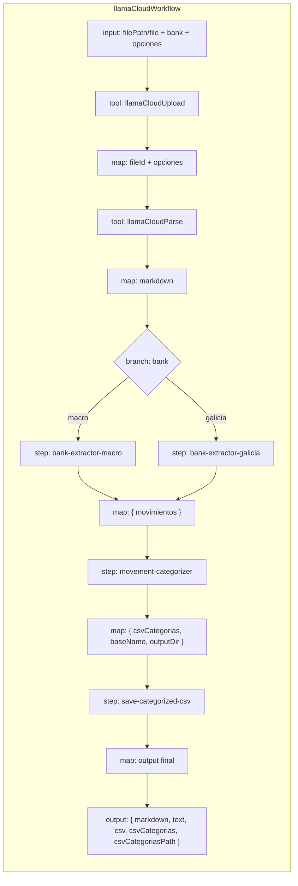

# Design: Movement Categorization

## Resumen

Se agrega al workflow `llamaCloudWorkflow` un paso de **categorización automática** de movimientos bancarios, ubicado **después** del extractor de banco (`bank-extractor-<bank>`) y **antes** de escribir el CSV final. Un agente dedicado (`movement-categorizer`) clasifica cada movimiento en una de 16 categorías contables (15 conocidas + `Desconocida`) usando el modelo `opencode-go/deepseek-v4-flash`. El resultado se serializa a CSV con una columna adicional `CATEGORIA` y se guarda en disco como `<base>_categorias.csv`.

Las categorías viven en `src/mastra/categories.ts` como única fuente de verdad, de modo que puedan reutilizarse desde el agente, el serializer y futuros consumidores.

## Decisión de arquitectura

| Opción | Descripción | Veredicto |
|--------|-------------|-----------|
| Agente dedicado + `createStep` + helper por lotes | Reutiliza el patrón de los extractores de banco (`Agent` + `createStep` + helper de chunking). Visible en Studio, trazable, testeable. | ✅ Correcto |
| Categorización inline en un `.map()` | Más compacto pero mezcla I/O/LLM en una transformación y pierde observabilidad de paso. | ❌ |
| Clasificador por regex/heurística | Determinista y barato, pero no cumple el requerimiento de usar `deepseek-v4-flash` y es frágil ante descripciones irregulares. | ❌ |

Se elige **agente dedicado + `createStep` + helper por lotes** para mantener consistencia con la arquitectura existente y aprovechar la observabilidad del grafo de workflow.

## Arquitectura



## Dependencia

| Paquete | Versión | Propósito |
|---------|---------|-----------|
| `@mastra/core` | 1.75.0 (ya instalado) | `Agent`, `createWorkflow`, `createStep`, `Workflow.then()`, `Workflow.map()`, `Workflow.branch()` |
| `zod` | ^4.4.3 (ya instalado) | Esquemas de salida estructurada |
| `node:fs` / `node:path` | built-in | Escritura del archivo CSV y derivación del nombre base |

No se agregan dependencias nuevas.

## Configuración

- **Modelo categorizador**: `opencode-go/deepseek-v4-flash` (verificado en el provider registry).
- **Justificación del modelo**: entre los 36 modelos disponibles en `opencode-go`, `deepseek-v4-flash` pertenece al tier *flash* (bajo costo/latencia), que es suficiente para una tarea de clasificación de texto en un enum cerrado. Es consistente con el agente general y la memoria observacional del proyecto, que ya usan este modelo. Las alternativas *pro* (p. ej. `deepseek-v4-pro`) o modelos de razonamiento/código (p. ej. `kimi-k2.7-code`) aportan capacidad innecesaria para este caso de uso.
- **API key**: `OPENCODE_API_KEY` (ya documentada en `.env.example`), nunca hardcodeada.
- **Tamaño de lote**: ~25 movimientos por llamada (ajustable). Se puede elevar si los extractos son cortos.

## Estructura de archivos

```
src/mastra/
├── categories.ts                                      # NUEVO: lista centralizada de categorías
├── index.ts                                           # MODIFICADO: registrar movementCategorizer
├── agents/
│   ├── agent.ts                                       # MODIFICADO (opcional): mencionar ruta guardada
│   └── bank-extractors/
│       ├── categories.ts                              # NUEVO (alternativa centralizada) → usar src/mastra/categories.ts
│       ├── categorizer.ts                             # NUEVO: agente movement-categorizer
│       ├── categorize.ts                              # NUEVO: helper categorizeMovements con lotes
│       ├── index.ts                                   # MODIFICADO: re-exports
│       └── types.ts                                   # MODIFICADO: schemas + serializer categorizado
├── tools/
│   └── process-bank-statement.ts                      # MODIFICADO: outputSchema + descripción
└── workflows/
    └── llama-cloud-workflow.ts                        # MODIFICADO: pasos categorize + save + output extendido
```

> La ubicación final de las categorías es `src/mastra/categories.ts` para maximizar la reusabilidad. Desde `agents/bank-extractors/types.ts` y `agents/bank-extractors/categorizer.ts` se importa de allí.

## Módulo centralizado: `src/mastra/categories.ts`

```typescript
import { z } from 'zod';

export const movementCategories = [
  'Bonificaciones',
  'Cheques emitidos',
  'Cobro de cheques',
  'Comisiones',
  'Compras',
  'Efectivo',
  'Impuestos',
  'Inversiones',
  'Pagos a proveedores',
  'Seguros',
  'Servicios',
  'Tarjetas',
  'Transferencias propias',
  'Transferencias recibidas',
  'Ventas',
  'Desconocida',
] as const;

export type MovementCategory = (typeof movementCategories)[number];

export const movementCategorySchema = z.enum(movementCategories);
```

## Tipos y serializer: `agents/bank-extractors/types.ts`

Se agregan los tipos/serializer sin cambiar `movimientoRowSchema`, `extractorOutputSchema`, `MovimientoRow` ni `movementsToCsv`:

```typescript
import { movementCategorySchema } from '../../categories';

export const categorizedMovimientoRowSchema = movimientoRowSchema.extend({
  categoria: movementCategorySchema,
});

export const categorizerOutputSchema = z.object({
  movimientos: z.array(categorizedMovimientoRowSchema),
});

export type CategorizedMovimientoRow = z.infer<typeof categorizedMovimientoRowSchema>;

export function categorizedMovementsToCsv(
  movimientos: CategorizedMovimientoRow[]
): string {
  const header = ['CUENTA', 'FECHA', 'DESCRIPCION', 'REFERENCIA', 'DEBITOS', 'CREDITOS', 'SALDO', 'CATEGORIA'];
  const escape = (value: string) => `"${value.replace(/"/g, '""')}"`;
  const rows = movimientos.map((m) =>
    [m.cuenta, m.fecha, m.descripcion, m.referencia, m.debitos, m.creditos, m.saldo, m.categoria]
      .map(escape)
      .join(',')
  );
  return [header.map(escape).join(','), ...rows].join('\n');
}
```

## Agente categorizador: `agents/bank-extractors/categorizer.ts`

```typescript
import { Agent } from '@mastra/core/agent';
import { opencodeGoHeaders } from '../opencode-headers';
import { movementCategories } from '../../categories';

export const movementCategorizer = new Agent({
  id: 'movement-categorizer',
  name: 'Movement Categorizer',
  description: 'Clasifica movimientos bancarios en categorías contables cerradas.',
  model: [
    {
      id: 'categorizer',
      model: 'opencode-go/deepseek-v4-flash',
      headers: opencodeGoHeaders,
    },
  ],
  instructions: `
Objetivo: Clasificar cada movimiento bancario en exactamente una categoría contable.

Categorías válidas (usa una de estas y solo estas):
${movementCategories.join('\n')}

Reglas:
1. Analizá la descripción del movimiento y el signo (débito = egreso, crédito = ingreso).
2. Asigná la categoría más específica posible.
3. Devolvé el movimiento completo (todos sus campos originales) agregando la clave "categoria".
4. Mantené el orden original de los movimientos. No agregues, elimines ni reordenes filas.
5. Si una descripción es ambigua o no tenés certeza suficiente, usá `Desconocida`.
6. La categoría `Desconocida` es válida y debe usarse cuando no sea posible determinar una de las 15 categorías conocidas.
`,
});
```

## Helper por lotes: `agents/bank-extractors/categorize.ts`

```typescript
import type { Agent } from '@mastra/core/agent';
import { categorizerOutputSchema, type MovimientoRow, type CategorizedMovimientoRow, type MovementCategory } from './types';

const BATCH_SIZE = 25;
const UNKNOWN_CATEGORY: MovementCategory = 'Desconocida';

export async function categorizeMovements({
  agent,
  movimientos,
}: {
  agent: Agent;
  movimientos: MovimientoRow[];
}): Promise<{ movimientos: CategorizedMovimientoRow[] }> {
  if (movimientos.length === 0) return { movimientos: [] };

  const resultados: CategorizedMovimientoRow[] = [];

  for (let i = 0; i < movimientos.length; i += BATCH_SIZE) {
    const batch = movimientos.slice(i, i + BATCH_SIZE);
    const prompt = `Clasificá los siguientes movimientos bancarios respetando el orden y agregando el campo "categoria". Si no podés determinar una categoría, usá "Desconocida":\n\n${JSON.stringify(batch, null, 2)}`;

    const res = await agent.generate(prompt, {
      structuredOutput: {
        schema: categorizerOutputSchema,
        jsonPromptInjection: 'inline',
      },
    });

    const object = res.object as { movimientos?: CategorizedMovimientoRow[] } | undefined;
    const returned = object?.movimientos ?? [];

    for (let j = 0; j < batch.length; j++) {
      resultados.push(returned[j] ?? { ...batch[j], categoria: UNKNOWN_CATEGORY });
    }
  }

  return { movimientos: resultados };
}
```

## Workflow: `llama-cloud-workflow.ts`

### Nuevos pasos

```typescript
const categorizeStepInputSchema = z.object({
  movimientos: z.array(movimientoRowSchema),
});

const categorizeStep = createStep({
  id: 'movement-categorizer',
  inputSchema: categorizeStepInputSchema,
  outputSchema: categorizerOutputSchema,
  execute: async ({ inputData }) =>
    categorizeMovements({ agent: movementCategorizer, movimientos: inputData.movimientos }),
});

const saveCategorizedCsvInputSchema = z.object({
  csvCategorias: z.string(),
  baseName: z.string(),
  outputDir: z.string(),
});

const saveCategorizedCsvStep = createStep({
  id: 'save-categorized-csv',
  inputSchema: saveCategorizedCsvInputSchema,
  outputSchema: z.object({
    csvCategorias: z.string(),
    csvCategoriasPath: z.string(),
  }),
  execute: async ({ inputData }) => {
    const filePath = path.join(inputData.outputDir, `${inputData.baseName}_categorias.csv`);
    fs.writeFileSync(filePath, inputData.csvCategorias, 'utf-8');
    return { csvCategorias: inputData.csvCategorias, csvCategoriasPath: filePath };
  },
});
```

### Nuevo output schema

```typescript
outputSchema: z.object({
  markdown: z.string(),
  text: z.string(),
  csv: z.string().describe('CSV original sin columna de categoría.'),
  csvCategorias: z.string().describe('CSV con columna CATEGORIA al final.'),
  csvCategoriasPath: z.string().describe('Ruta del archivo <base>_categorias.csv guardado en disco.'),
})
```

### Pipeline extendida

```typescript
export const llamaCloudWorkflow = createWorkflow({
  id: 'llama-cloud-workflow',
  inputSchema,
  outputSchema,
})
  .tool(llamaCloudUpload, {}, { id: 'upload' })
  .map(async ({ inputData, getInitData }) => ({ ... }))
  .tool(llamaCloudParse, {}, { id: 'parse' })
  .map(async ({ inputData }) => ({ markdown: inputData.markdown }))
  .branch(bankIds.map((bank) => [
    async ({ getInitData }) => getInitData<InputType>().bank === bank,
    makeExtractorStep(bank),
  ]))
  .map(async ({ inputData, getInitData }) => {
    const bank = getInitData<InputType>().bank;
    const stepId = `bank-extractor-${bank}`;
    const result = (inputData as Record<string, { movimientos: MovimientoRow[] } | undefined>)[stepId];
    return { movimientos: result?.movimientos ?? [] };
  })
  .then(categorizeStep)
  .map(async ({ inputData, getStepResult, getInitData }) => {
    const init = getInitData<InputType>();
    let baseName: string;
    let outputDir: string;
    if (init.filePath) {
      outputDir = path.dirname(init.filePath);
      baseName = path.basename(init.filePath, path.extname(init.filePath));
    } else {
      outputDir = path.join(process.cwd(), 'workspace');
      baseName = path.basename(init.file!.name, path.extname(init.file!.name));
    }
    return {
      csvCategorias: categorizedMovementsToCsv(inputData.movimientos),
      baseName,
      outputDir,
    };
  })
  .then(saveCategorizedCsvStep)
  .map(async ({ getStepResult, getInitData }) => {
    const { markdown, text } = getStepResult<{ markdown: string; text: string }>('parse');
    const bank = getInitData<InputType>().bank;
    const extractorResult = getStepResult<{ movimientos: MovimientoRow[] }>(`bank-extractor-${bank}`);
    const saveResult = getStepResult<{ csvCategorias: string; csvCategoriasPath: string }>('save-categorized-csv');
    return {
      markdown,
      text,
      csv: movementsToCsv(extractorResult?.movimientos ?? []),
      csvCategorias: saveResult.csvCategorias,
      csvCategoriasPath: saveResult.csvCategoriasPath,
    };
  })
  .commit();
```

> El `.refine` del `inputSchema` garantiza que siempre existe `filePath` o `file`, por lo que el fallback `init.file!` es seguro.

## Tool: `process-bank-statement.ts`

Actualizar `outputSchema` y `description`:

```typescript
outputSchema: z.object({
  markdown: z.string(),
  text: z.string(),
  csv: z.string().describe('CSV original sin categoría.'),
  csvCategorias: z.string().describe('CSV con columna CATEGORIA.'),
  csvCategoriasPath: z.string().describe('Ruta del archivo *_categorias.csv guardado.'),
})
```

El `execute` sigue devolviendo `result.result` sin cambios lógicos.

## Registro en `src/mastra/index.ts`

```typescript
import { movementCategorizer } from './agents/bank-extractors/categorizer';

export const mastra = new Mastra({
  // ...
  agents: {
    agent,
    movementCategorizer,
    ...Object.fromEntries(Object.values(bankExtractors).map((cfg) => [cfg.agent.id, cfg.agent])),
  },
  // ...
});
```

## Manejo de errores

- **`filePath` o `file` ausente** → validación del `inputSchema` falla antes de ejecutar.
- **Categorizador devuelve filas de más/menos** → el helper reconcilia por posición: rellena las filas faltantes con `Desconocida` y trunca las sobrantes; el workflow continúa.
- **Categoría fuera de la lista** → `movementCategorySchema` (Zod structured output) rechaza la respuesta del modelo; si el structured output falla, se puede optar por reintentar o, en última instancia, asignar `Desconocida`.
- **Error de escritura en disco** (permisos, path inválido) → el paso `save-categorized-csv` falla con el error de Node.js.
- **Movimientos vacíos** → se genera el CSV con solo el encabezado y se escribe el archivo vacío de contenido (solo header).

## Verificación

1. Compilación: `npx tsc --noEmit`.
2. Registro: `npx mastra api agent list --pretty` lista `movement-categorizer`.
3. Serializer aislado: `categorizedMovementsToCsv` con filas de ejemplo (header `CATEGORIA` al final, escape RFC 4180).
4. End-to-end:
   ```bash
   npx mastra api workflow run start llama-cloud-workflow \
     '{"inputData":{"filePath":"ruta/al/extracto.pdf","bank":"macro"}}'
   ```
   Debe devolver `{ markdown, text, csv, csvCategorias, csvCategoriasPath }` y crear `extracto_categorias.csv` junto al PDF.
5. Caso base64: ejecutar con `file: { name, data }` y verificar que se crea `<name-without-ext>_categorias.csv` en la carpeta `workspace/` de Mastra.
